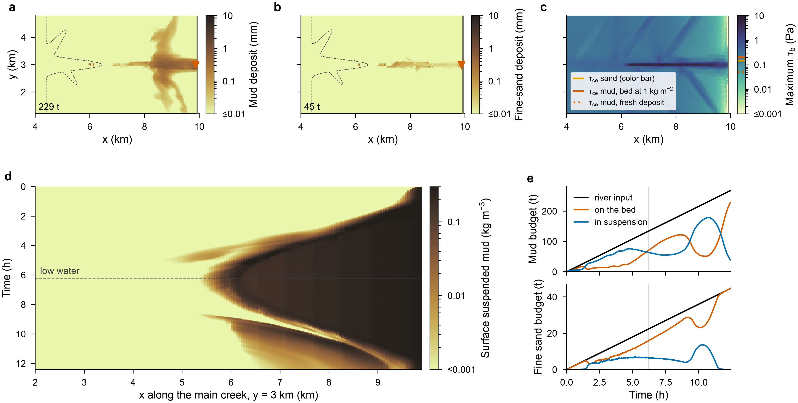

# pkg/sediment — suspended sediment and a layered bed for MITgcm

`pkg/sediment` carries one to four sediment classes (mud, sand) as
pTracers. Each step it adds a river source, then applies settling,
deposition to the bed and erosion from the bed. The bed is a single store
per class, or a layered bed with consolidation and armoring, after the ROMS
Community Sediment Transport Modeling System (CSTMS; Warner et al. 2008,
Sherwood et al. 2018). Bed stress comes from the near-bed current, and can
include waves (from files or a parametric wind sea). Suspended + bed mass is
conserved to round-off in every column.

The package is **standalone**: it needs only pkg/ptracers. It also works
with these packages, but none of them is required:

- pkg/wetdry (tidal flats that dry and flood; in this repository,
  `pkg/wetdry`): no erosion from dry columns and no deposition from the
  water film
- pkg/seaice: sea-ice cover damps the waves (`sedWaveIce`)
- pkg/mangrove (roots shelter the bed, the forest damps the waves): not in
  this repository yet; the hooks compile only with `ALLOW_MANGROVE`

Author: Dustin Carroll (SJSU / JPL), 2026. Developed against MITgcm
`master` at commit `d861cd501` ("Fix pkg/cheapaml flux option LANL",
#1001), on the development branch `wetdry`.

## Contents

```
sediment/
  README.md             this file
  src/                  the package itself (pkg/sediment): 11 .F files,
                        SEDIMENT.h, SEDIMENT_OPTIONS.h
  mitgcm_changes/       MITgcm files changed to call the package
    sediment_hooks.patch               against stock MITgcm d861cd501
    sediment_hooks_with_wetdry.patch   against d861cd501 + pkg/wetdry's
                                       wetdry_hooks.patch
    model/ pkg/         the 9 files, complete, at their MITgcm paths
                        (stock d861cd501 + the sediment hooks only)
  verification/
    sediment_seiche/    standalone test, no pkg/wetdry (3 runs)
    sediment_mudflat/   tidal mudflat with pkg/wetdry (2 runs)
  doc/figures/          figure of the sediment_mudflat run
```

## Install

From the top of an MITgcm checkout (tested with `d861cd501`; the patch
touches 9 files and usually applies to nearby versions too).

Without pkg/wetdry:

```sh
cp -r <path>/sediment/src  pkg/sediment
git apply <path>/sediment/mitgcm_changes/sediment_hooks.patch
cp -r <path>/sediment/verification/sediment_seiche verification/
```

With pkg/wetdry, install pkg/wetdry first (see `../wetdry/README.md`),
then:

```sh
cp -r <path>/sediment/src  pkg/sediment
git apply <path>/sediment/mitgcm_changes/sediment_hooks_with_wetdry.patch
cp -r <path>/sediment/verification/sediment_* verification/
```

Both patches put the same hooks in the same places. The two exist only
because both packages add lines next to the same MYPACKAGE hooks. If a
patch does not apply, copy the files from `mitgcm_changes/model` and
`mitgcm_changes/pkg` (complete files, stock `d861cd501` + the sediment
hooks) and merge by hand. The hooks are:

| File | Hook |
|---|---|
| `model/inc/PARAMS.h` | `useSEDIMENT` flag |
| `model/src/packages_boot.F` | reads `useSEDIMENT` from `data.pkg` |
| `model/src/packages_readparms.F`, `packages_check.F`, `packages_init_fixed.F`, `packages_init_variables.F`, `packages_write_pickup.F` | `SEDIMENT_READPARMS`, `_CHECK`, `_INIT_FIXED`, `_INIT_VARIA`, `_WRITE_PICKUP` |
| `model/src/forward_step.F` | `SEDIMENT_STEP` after the pTracer step (after GCHEM, before the blocking exchanges) |
| `pkg/ptracers/ptracers_apply_forcing.F` | `SEDIMENT_ADD_TENDENCY`: sediment carried by the added fluid (`addMass`, e.g. a river) |

Then, in your experiment:

1. Add `ptracers` and `sediment` to `code/packages.conf`.
2. Set `PTRACERS_num` in `code/PTRACERS_SIZE.h` to hold the sediment classes.
3. Set `usePTRACERS=.TRUE.` and `useSEDIMENT=.TRUE.` in `data.pkg`.
4. Write a `data.sediment` (namelists below) and give each sediment
   pTracer units of kg/m^3 in `data.ptracers`.
5. For a river source, `#define ALLOW_ADDFLUID` in `CPP_OPTIONS.h` and use
   `addMassFile` with `selectAddFluid=1`.

Run the tests with testreport, from MITgcm's `verification/` directory:

```sh
./testreport -t sediment_seiche
```

```sh
./testreport -t "sediment_seiche sediment_mudflat"
```

## Required model settings

`sediment_check` stops the run unless:

- pkg/ptracers is compiled and `usePTRACERS=.TRUE.`
- `1 <= sedNcl <= 4`; each class has its own pTracer (`sedPtrIdx`) in use
- `sedWs, sedEroM, sedRiverC >= 0` and `sedTauCE, sedBulkRho > 0`
- `0 <= sedNlay <= 10`; the fluff layer (`sedConsTime > 0`) and the
  layered bed (`sedNlay > 0`) are not used together
- with the non-linear free surface: `select_rStar > 0` (r\*), not the
  surface-level variant `select_rStar=0`

The linear free surface and r\* both work (`sediment_seiche` tests both).
The package also builds and runs with the stock `CPP_OPTIONS.h` (no
`NONLIN_FRSURF`, no `ALLOW_ADDFLUID`; checked with `sediment_seiche`).

## Method (each time step, each column)

`SEDIMENT_STEP` runs on the new pTracer concentrations C_k (kg/m^3), as
operator splitting after the tracer step. With layer thickness h_k, the
mass is m_k = C_k h_k (kg/m^2).

1. **River source.** The added fluid (`addMass`) carries `sedRiverC` (or
   the 2-D map `sedRiverCFile`), applied as a tracer tendency like T and S.
2. **Settling.** Each layer loses min(w_s Δt C_k, m_k) downward (explicit,
   limited, so it stays stable in thin r\* layers).
3. **Deposition.** The settling flux out of the bottom wet layer deposits
   on the bed: all of it, or the fraction 1 − τ_b/τ_cd if `sedTauCD > 0`
   (Krone). In columns shallower than 2·`sedDryDepth` deposition ramps to
   zero (the wetdry film), unless `sedDryDeposit`.
4. **Erosion.** E = M (τ_b/τ_ce − 1) when τ_b > τ_ce and the column is
   deeper than `sedDryDepth`, limited to the bed mass. The eroded mass
   goes into the lowest `sedRefDepth` of the column.
5. **Bed stress.** τ_b = ρ (C_d |u_b|² + r |u_b|), with
   `bottomDragQuadratic` and `bottomDragLinear` from `data`, and u_b the
   mean velocity of the lowest `sedRefDepth` (0.5 m). The mean is used
   because the bottom cell alone can be a thin partial cell whose
   velocity the drag damps. With waves: the maximum wave + current stress
   (Soulsby 1995), with the wave friction factor
   f_w = 1.39 (A/z_0)^−0.52 (Soulsby 1997).

Bed options (choose one):

- **Single store** (default): one bed mass per class.
- **Fluff layer** (`sedConsTime > 0`): fresh deposit enters a fluff layer
  that erodes at `sedTauCEf`, `sedEroMf` and consolidates into the bed
  with e-folding time `sedConsTime`.
- **Layered bed** (`sedNlay > 0`, namelist `SEDIMENT_PARM02`): after ROMS
  CSTMS (Sherwood et al. 2018, Sects. 2.3–2.6; Moriarty et al. 2017).
  Layer 1 is the active layer, of thickness
  z_a = max(`sedZaMin`, `sedZaCoef`·(τ_b − τ_ce)) (Harris and Wiberg 1997).
  Only the active layer erodes, by class, with
  E_i = M_i (1 − φ) f_i (τ_b/τ_ce,i − 1). Each layer has a bulk critical
  stress τ_cb that relaxes toward the equilibrium profile
  τ_cb,eq = exp((ln z_m − offset)/slope) (Sherwood et al. Eq. 4):
  consolidation with `sedTcons`, swelling with `sedTswell`. A bed that
  holds more than `sedFcLo`..`sedFcHi` of cohesive classes turns
  cohesive: τ_ce,i = max(P_c τ_cb + (1 − P_c) τ_ce,i, τ_ce,i)
  (Sherwood et al. Eq. 6). Material moved below the active layer starts a
  new layer each `sedLayMass` kg/m^2; the two deepest layers then merge.

Waves (`sedWaveMode`, namelist `SEDIMENT_PARM03`):

- `0`: no waves (default)
- `1`: bottom orbital velocity, period and (optional) direction from files
  (e.g. WAVEWATCH III UBR and a mean period)
- `2`: parametric fetch- and depth-limited wind sea (Young and Verhagen
  1996) from `sedWindSpeed`, `sedWindDir`, `sedFetch`; Hs ≤ γh;
  orbital velocity from linear theory (kh from Guo 2002)
- `3`: Hs, period and (optional) direction from files (e.g. WAVEWATCH III
  HTSGW, PERPW, DIRPW on the model grid), orbital velocity as in mode 2

File records are cyclic, `sedWaveNrec` records every `sedWaveDt` seconds,
linear in time between records.

## Parameters (`data.sediment`)

Namelist `SEDIMENT_PARM01` (required). Per-class values are lists, one
value per class.

| Parameter | Default | Meaning |
|---|---|---|
| `sedNcl` | 1 | number of classes (≤ 4) |
| `sedPtrIdx` | 1, 2, … | pTracer index of each class (kg/m^3) |
| `sedWs` | 0.5e-3 m/s | settling velocity |
| `sedTauCE` | 0.2 Pa | critical stress for erosion (with a layered bed: the particle value) |
| `sedEroM` | 5e-5 kg/m²/s | erosion rate constant M |
| `sedTauCD` | 0 (off) | critical stress for deposition (Krone) |
| `sedRiverC` | 0 | concentration of the added fluid (kg/m^3) |
| `sedRiverCFile` | none | 2-D map of that concentration; replaces `sedRiverC` where given |
| `sedBulkRho` | 500 kg/m^3 | dry bulk density (equivalent deposit thickness only) |
| `sedBedFile` | none (clean bed) | initial bed mass (kg/m^2) |
| `sedDryDepth` | 0.10 m | no erosion from shallower columns; deposition ramps off below 2× this |
| `sedDryDeposit` | F | deposit from drying columns too |
| `sedRefDepth` | 0.5 m | near-bed layer for the bed-stress velocity (≤ 0: bottom wet cell only) |
| `sedConsTime` | 0 (off) | fluff layer consolidation time (s) |
| `sedTauCEf`, `sedEroMf` | bed values | critical stress and rate constant of the fluff |
| `sedMonFreq` | monitorFreq | `%SEDIMENT_MON` interval (s) |

Namelist `SEDIMENT_PARM02` (optional, layered bed):

| Parameter | Default | Meaning |
|---|---|---|
| `sedNlay` | 0 (off) | number of bed layers (≤ 10) |
| `sedCohesive` | F | per class: cohesive (mud) |
| `sedPorosity` | 0 | bed porosity φ |
| `sedFcLo`, `sedFcHi` | 0.03, 0.2 | cohesive fraction where the bed starts / ends turning cohesive |
| `sedTcbNew` | 0.05 Pa | bulk critical stress of fresh deposit |
| `sedTcbOffset`, `sedTcbSlope` | 0, 2 | equilibrium τ_cb profile (Sherwood et al. Eq. 4) |
| `sedTcbMin`, `sedTcbMax` | 0.05, 5 Pa | limits of τ_cb |
| `sedTcons`, `sedTswell` | 1 d, 10 d | consolidation and swelling time scales |
| `sedZaCoef`, `sedZaMin` | 0.007 m/Pa, 0.5 mm | active layer thickness |
| `sedLayMass` | 1 kg/m^2 | mass that starts a new layer |

Namelist `SEDIMENT_PARM03` (optional, waves):

| Parameter | Default | Meaning |
|---|---|---|
| `sedWaveMode` | 0 (off) | 1: u_b + period files; 2: parametric wind sea; 3: Hs + period files |
| `sedWaveUbFile`, `sedWavePerFile`, `sedWaveDirFile`, `sedWaveHsFile` | none | wave files (direction optional) |
| `sedWaveNrec`, `sedWaveDt` | 1, 0 | records in the files and their interval (s) |
| `sedWindSpeed`, `sedWindDir` | 0, 0 | 10 m wind (m/s) and the direction it blows toward (deg ccw from +x) |
| `sedFetch` | 10 km | fetch (mode 2) |
| `sedWaveGamma` | 0.5 | breaking limit Hs ≤ γh |
| `sedZ0` | 0.2 mm | bed roughness length for f_w |
| `sedWaveIce` | T | orbital velocity times (1 − sea-ice area) |

## Diagnostics, monitor and pickups

Diagnostics: `SEDBEDnn`, `SEDDEPnn`, `SEDEROnn` (bed mass, deposition and
erosion of class nn), `SEDTAUB` (bed stress), `SEDTAUW` (wave stress),
`SEDTCB` (critical stress of the active layer), `SEDUBW` (orbital
velocity), `SEDHSW` (Hs, mode 2), `SEDZA` and `SEDACT` (active layer
thickness and mass).

`%SEDIMENT_MON` prints, for each class, the suspended and bed mass (kg),
the cumulative river input, deposition and erosion, and the largest
column budget error of a step (round-off). The pickup files
`pickup_sediment`, `pickup_sedfluff`, `pickup_sedbed`, `pickup_sedtcb` and
`pickup_sedimentcum` hold the bed and the budgets for restarts. They are
always 64-bit, whatever `readBinaryPrec`/`writeBinaryPrec`. A restart
gives the same `%SEDIMENT_MON` lines as a straight run (checked with the
layered bed in `sediment_seiche`).

## Verification experiments

Each experiment folder has its own `README.md`.

| Experiment | Runs | What it tests | Needs |
|---|---|---|---|
| `sediment_seiche` | main, `rstar`, `layers` | a 0.3 m seiche in a closed 20 km × 10 m basin erodes a mud + sand bed; linear free surface, r\*, layered bed | ptracers |
| `sediment_mudflat` | main, `waves` | river mud and sand on the macrotidal mudflat of `wetdry_mudflat` (1 M2 tide, layered bed); `waves` adds a parametric wind sea | ptracers, wetdry, obcs, kpp, rbcs |

Both pass testreport on arm64 macOS (conda-forge gfortran, optfile
`darwin_arm64_gfortran_conda`); see each README for what the reference
outputs hold.



*River sediment on the macrotidal mudflat over one M2 tide (the
`sediment_mudflat` set-up, run on the development branch): a, b) mud and
fine-sand deposit; c) maximum bed stress; d) surface suspended mud along
the main creek; e) budget of each class (river input = bed +
suspension).*

## Limitations

- No adjoint.
- No bedload and no bed-level change: the bed is a mass store, so the
  model bathymetry does not change.
- Settling is explicit (limited per layer): very fast classes in thin
  layers settle at the limit, not at `sedWs`.
- No flocculation; settling velocity is constant per class.
- The bed stress uses the model's bottom drag coefficients (no separate
  bed roughness for currents).

## References

- Guo, J. (2002). Simple and explicit solution of wave dispersion equation. Coastal Engineering, 45, 71–74.
- Harris, C. K., & Wiberg, P. L. (1997). Approaches to quantifying long-term continental shelf sediment transport with an example from the Northern California STRESS mid-shelf site. Continental Shelf Research, 17, 1389–1418.
- Moriarty, J. M., Harris, C. K., Fennel, K., Friedrichs, M. A. M., Xu, K., & Rabouille, C. (2017). The roles of resuspension, diffusion and biogeochemical processes on oxygen dynamics offshore of the Rhône River, France: a numerical modeling study. Biogeosciences, 14, 1919–1946.
- Sherwood, C. R., Aretxabaleta, A. L., Harris, C. K., Rinehimer, J. P., Verney, R., & Ferré, B. (2018). Cohesive and mixed sediment in the Regional Ocean Modeling System (ROMS v3.6) implemented in the Coupled Ocean–Atmosphere–Wave–Sediment Transport Modeling System (COAWST r1234). Geoscientific Model Development, 11, 1849–1871.
- Soulsby, R. (1997). Dynamics of Marine Sands. Thomas Telford, London.
- Soulsby, R. L. (1995). Bed shear-stresses due to combined waves and currents. In Advances in Coastal Morphodynamics, Delft Hydraulics, 4.20–4.23.
- Warner, J. C., Sherwood, C. R., Signell, R. P., Harris, C. K., & Arango, H. G. (2008). Development of a three-dimensional, regional, coupled wave, current, and sediment-transport model. Computers & Geosciences, 34, 1284–1306.
- Young, I. R., & Verhagen, L. A. (1996). The growth of fetch limited waves in water of finite depth. Part 1. Total energy and peak frequency. Coastal Engineering, 29, 47–78.
